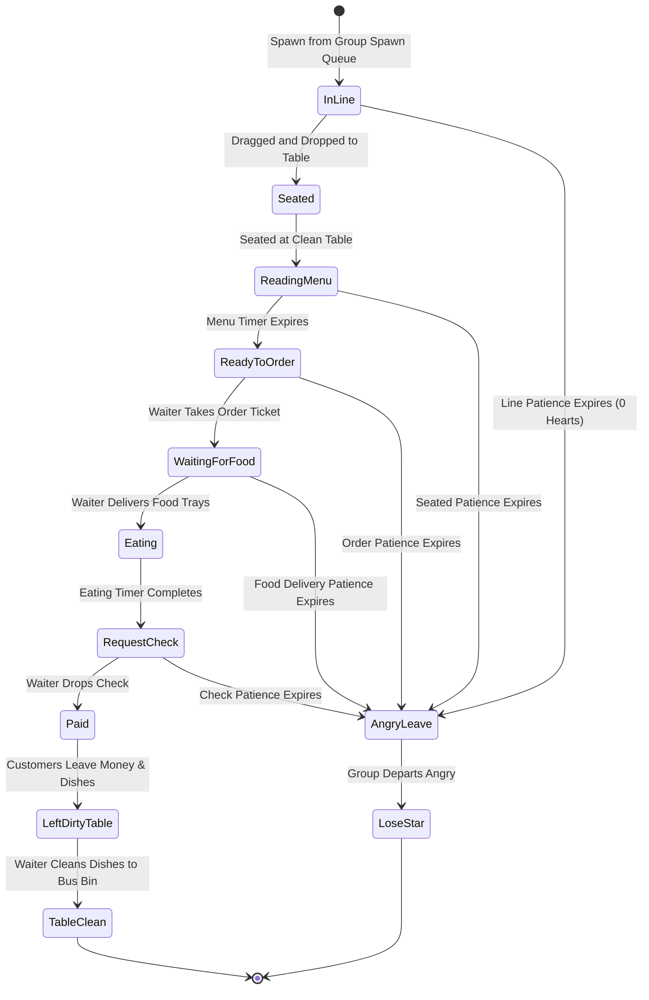
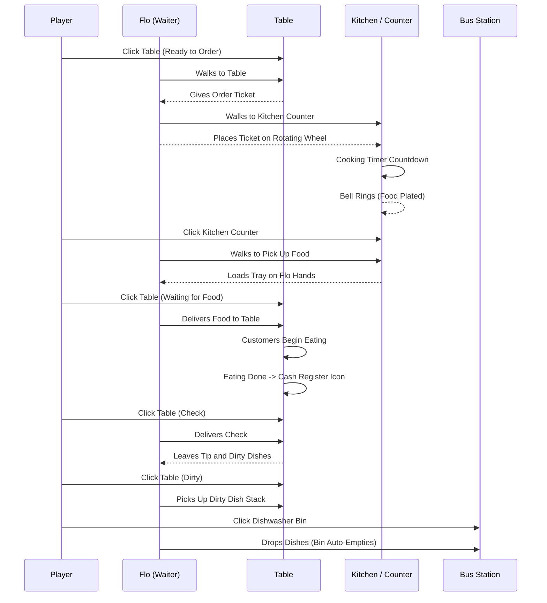
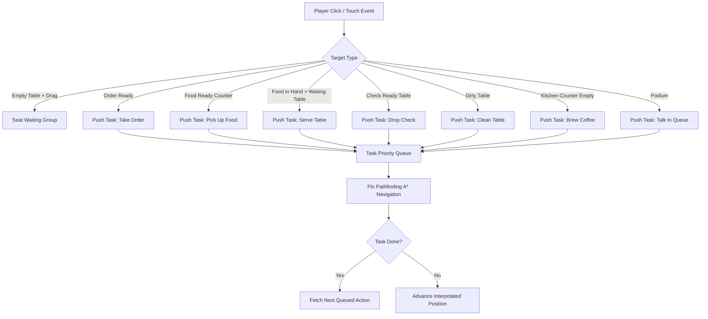
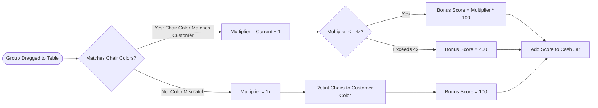

# Technical Architecture & Reimplementation Guide

Made by Nirusaki.

This document details the reverse engineering and modern Rust reimplementation of Diner Dash (original 2004 release). It contrasts the legacy Macromedia Director architecture against the new native Rust engine, explaining how old flaws were solved and detailing function-by-function mapping.

---

## 1. The Legacy Architecture (Macromedia Director & Lingo)

The original 2004 game was built with **Macromedia Director 8.5 / MX** using the **Lingo** scripting language.

### How the Old System Worked

1. **The Director Score and Casts**:
   - Assets and code were packed into Director Cast libraries (`.cst` and `.dcr` chunks): `conf.cst`, `game.cst`, `layout.cst`, `mode.cst`, and `xtras`.
   - Lingo scripts were divided into "Parent Scripts" (pseudo-classes) and "Movie Scripts" (global functions).
   - Bitmaps, audio clips, and vector shapes were referenced by member names inside casts (e.g. `member("moneyjar_1", "gfx.screens")`).

2. **Global State and Dynamic Proplists**:
   - The entire engine hung off a single global root variable: `global glob`.
   - Every manager was stored as a proplist under `glob.managers`:
     - `glob.managers.game` (`game_manager.ls`)
     - `glob.managers.node` (`node_manager.ls`)
     - `glob.managers.savegame` (`savegame_manager.ls`)
     - `glob.managers.sound` (`sound_manager.ls`)
     - `glob.managers.config` (`config_manager.ls`)
   - Objects communicated by passing dynamic property lists (e.g. `[#target: me, #handler: #clickOK, #Args: i]`).

### Why the Old Architecture Was Problematic

1. **Frame-Rate Coupled Simulation**:
   - The simulation loop was tied to Director movie frame events (`on stepFrame`, `on exitFrame`).
   - If CPU performance fluctuated or display refresh rate exceeded the original 30/60 FPS expectation, timers either drifted or accelerated out of control.
   - Patience decay and movement calculations did not use true delta time (`dt`), creating inconsistent difficulty on modern hardware.

2. **Global Mutable State and Spaghetti Dependencies**:
   - Any script could mutate any field of any manager across the entire game (e.g., `glob.managers.game.waiter.carrySlots = ...`).
   - No data isolation or encapsulation existed; changing one variable in `game_manager.ls` broke implicit assumptions in `waiter.ls` and `sitter.ls`.

3. **Untyped Dynamic Property Lists**:
   - Missing keys in property lists silently evaluated to `VOID` rather than raising errors.
   - Typos in event symbols (e.g. `#clickOk` vs `#clickOK`) failed silently, leaving UI buttons unresponsive without any stack trace.

4. **Resource and Memory Leaks**:
   - Director relied on reference counting without cycle detection (`voidRefs(me)` manual sweeps).
   - Text members, movie clips, and audio channels often leaked across stage transitions, requiring frequent game restarts.

5. **Fixed Resolution and Hardcoded Surfaces**:
   - The original engine assumed a strict 800x600 window.
   - Display scaling on high-DPI displays or mobile screens resulted in blurry scaling or broken mouse coordinate mapping.

---

## 2. The Modern Rust Architecture

The rewrite is split into three clean layers:

```
+----------------------------------------------------------------+
|                        Frontends                               |
|   diner-dash-native (Macroquad)   |   diner-dash-wasm (Web)    |
|   - Linux Wayland / X11           |   - Canvas 2D / WebGL      |
|   - Windows x64                   |   - Web Audio              |
|   - Android (Touch + Stretch)     |   - LocalStorage Save      |
+----------------------------------------------------------------+
                               |
                               v
+----------------------------------------------------------------+
|                    diner-dash-engine                           |
|   - Pure deterministic logic without windowing dependencies   |
|   - RoomManager, Waiter, Sitters, Kitchen, Tutorials           |
|   - Delta-time (dt) fixed simulation updates                   |
|   - Serde JSON persistence and multi-profile snapshotting      |
+----------------------------------------------------------------+
```

### Core Design Improvements

1. **Strict Decoupling**:
   - `diner-dash-engine` has zero dependencies on rendering or windowing libraries. It can run in automated tests, headless servers, web browsers, or native mobile targets.
2. **Deterministic Time-Stepping**:
   - The physics, mood decay, movement, and animations advance using strict delta time: `update(dt: f32)`.
   - Mood timers scale predictably regardless of system frame rate.
3. **Type-Safe Entity Identification**:
   - Strong newtypes (`TableId(u64)`, `SitterId(u64)`, `GroupId(u64)`) prevent table and customer handle confusion.
4. **Resilient Memory Management**:
   - Zero garbage collection pauses, zero manual `voidRefs` sweeps, guaranteed leak-free execution through Rust ownership.

---

## 3. Function Call & Handler Mapping Table

| Original Lingo Handler (`decompiled_lingo/`) | Reimplemented Rust Function (`engine/src/`, `native/src/`) | Responsibility |
|---|---|---|
| `game_manager.new(me, m)` | `GameManager::new(config: GameConfig)` | Initializes restaurant simulation, room tables, queue, waiter, and hud. |
| `game_manager.init(me, ...)` | `GameManager::init(mode, stage, level, diff)` | Loads stage layout, customer queues, and level goals. |
| `game_manager.step(me)` | `GameManager::update(dt: f32)` | Advances waiter movement, customer patience, kitchen cooking, and score. |
| `game_manager.clickTable(me, tid)` | `GameManager::click_table(table_id: TableId)` | Flo navigation: take order, serve food, deliver check, clear dirty dishes. |
| `game_manager.clickKitchen(me)` | `GameManager::click_kitchen()` | Flo navigates to cook counter to pick up prepared dishes. |
| `game_manager.clickPodium(me)` | `GameManager::click_podium()` | Flo greets waiting line at the podium to restore group heart patience. |
| `game_manager.setMoneyLevel(me)` | `GameManager::update_money_jar()` | Computes current money jar fill frame based on minimum tip goal. |
| `waiter.step(me)` | `Waiter::update(dt, &mut world)` | Evaluates waiter task queue, A* walking path, and carrying slots. |
| `waiter.pickUpOrder(me, ...)` | `Waiter::pick_up_order(table_id)` | Adds order ticket to waiter tray and queues task to drop ticket at kitchen. |
| `waiter.serveFood(me, ...)` | `Waiter::serve_food(table_id)` | Transfers plated food from Flo's hands to dining customers. |
| `waiter.clearTable(me, ...)` | `Waiter::clear_table(table_id)` | Collects dirty dish stack and routes Flo to dish bus station. |
| `sitter.step(me)` | `SitterSystem::update(dt, &mut world)` | Updates customer heart timers, eating state, and mood deterioration. |
| `sitter.eat(me)` | `SitterSystem::transition_to_eating()` | Customers consume meals, timer ticks until check is requested. |
| `room.seatGroup(me, gid, tid)` | `RoomManager::seat_group(group_id, table_id)` | Transfers group from queue to table chairs; applies seat color bonus. |
| `mode.options.setMusic(me, b)` | `Audio::set_music(&mut self, enabled: bool)` | Toggles background music and manages active sound handle. |
| `mode.options.setSFX(me, b)` | `Audio::set_sfx(&mut self, enabled: bool)` | Toggles sound effect playback. |
| `mode.login.selectSlot(me, num)` | `App::action(Action::SelectProfile(idx))` | Switches active player profile and reloads save file. |
| `mode.login.clickOK(me)` | `save::create_profile(name: &str)` | Registers a new player profile slot (up to 10 slots). |
| `mode.login.clickDelete(me)` | `save::delete_profile(name: &str)` | Removes player profile and deletes associated save data. |
| `mode.hiscore.setData(me, dat)` | `save::record_high_score(mode, name, score)` | Inserts top 10 score rankings into persistent storage. |
| `savegame_manager.saveState(me)` | `save::store(profile, game)` | Atomically writes session snapshot JSON to platform storage. |
| `savegame_manager.loadState(me)` | `save::load(profile)` | Deserializes active profile and restores in-progress shift. |

---

## 4. Architecture Diagrams

### A. Customer Group Lifecycle State Machine



---

### B. Kitchen and Order Delivery Pipeline



---

### C. Waiter Task Queue Management



---

### D. Seat Color Matching Multiplier Chain



---

## 5. Storage and Multi-Profile System

All save data is serialized with **Serde JSON** and isolated per player profile:

- Global directory index: `profiles.json` (Stores player list and active profile name).
- Global high scores: `high_scores.json` (Preserves top 10 Career and Endless rankings).
- Global options: `options.json` (Music, SFX, fullscreen, and Android stretch modes).
- Per-profile saves: `save_<name>.json` (Stores career levels unlocked, star counts, and upgrades).

Atomic temporary file writing (`save_<name>.json.tmp` followed by rename) ensures that game progress is protected against crashes or power loss.

